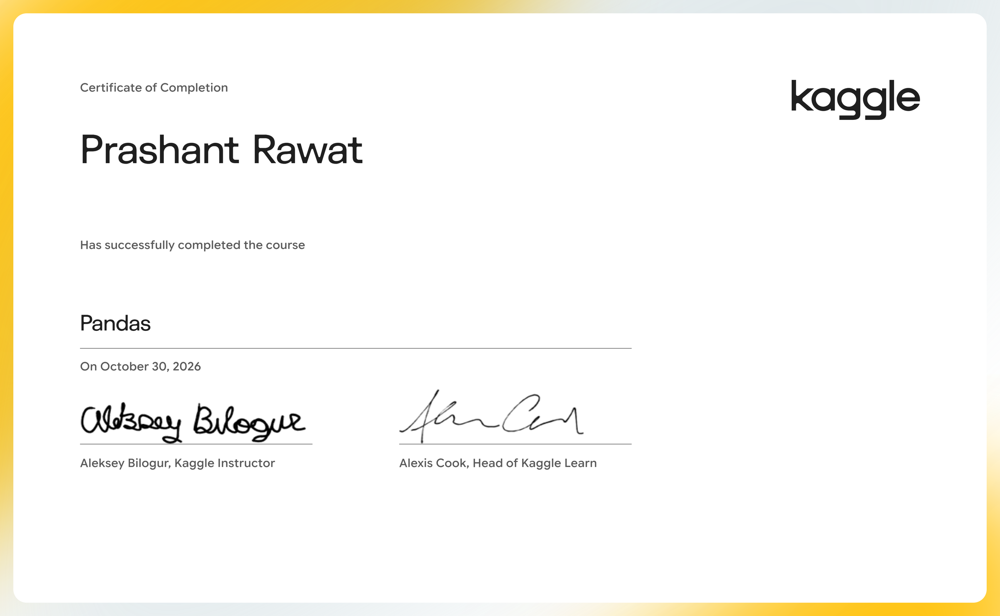

# Pandas

Solve short hands-on challenges to perfect your data manipulation skills.

- Course: [Pandas on Kaggle Learn](https://www.kaggle.com/learn/pandas)
- Instructor(s): Aleksey Bilogur
- Completed: 2026-10-30

## Lessons

| # | Lesson | Tutorial | Exercise | Solved exercise | Notes |
|---|---|---|---|---|---|
| 1 | Creating, Reading and Writing | [ipynb](01-Creating-Reading-and-Writing/tutorial.ipynb) · [md](01-Creating-Reading-and-Writing/tutorial.md) | [ipynb](01-Creating-Reading-and-Writing/exercise.ipynb) · [md](01-Creating-Reading-and-Writing/exercise.md) | [ipynb](01-Creating-Reading-and-Writing/exercise-solved.ipynb) · [md](01-Creating-Reading-and-Writing/exercise-solved.md) | [notes](01-Creating-Reading-and-Writing/notes.md) |
| 2 | Indexing, Selecting & Assigning | [ipynb](02-Indexing-Selecting-and-Assigning/tutorial.ipynb) · [md](02-Indexing-Selecting-and-Assigning/tutorial.md) | [ipynb](02-Indexing-Selecting-and-Assigning/exercise.ipynb) · [md](02-Indexing-Selecting-and-Assigning/exercise.md) | [ipynb](02-Indexing-Selecting-and-Assigning/exercise-solved.ipynb) · [md](02-Indexing-Selecting-and-Assigning/exercise-solved.md) | [notes](02-Indexing-Selecting-and-Assigning/notes.md) |
| 3 | Summary Functions and Maps | [ipynb](03-Summary-Functions-and-Maps/tutorial.ipynb) · [md](03-Summary-Functions-and-Maps/tutorial.md) | [ipynb](03-Summary-Functions-and-Maps/exercise.ipynb) · [md](03-Summary-Functions-and-Maps/exercise.md) | [ipynb](03-Summary-Functions-and-Maps/exercise-solved.ipynb) · [md](03-Summary-Functions-and-Maps/exercise-solved.md) | [notes](03-Summary-Functions-and-Maps/notes.md) |
| 4 | Grouping and Sorting | [ipynb](04-Grouping-and-Sorting/tutorial.ipynb) · [md](04-Grouping-and-Sorting/tutorial.md) | [ipynb](04-Grouping-and-Sorting/exercise.ipynb) · [md](04-Grouping-and-Sorting/exercise.md) | [ipynb](04-Grouping-and-Sorting/exercise-solved.ipynb) · [md](04-Grouping-and-Sorting/exercise-solved.md) | [notes](04-Grouping-and-Sorting/notes.md) |
| 5 | Data Types and Missing Values | [ipynb](05-Data-Types-and-Missing-Values/tutorial.ipynb) · [md](05-Data-Types-and-Missing-Values/tutorial.md) | [ipynb](05-Data-Types-and-Missing-Values/exercise.ipynb) · [md](05-Data-Types-and-Missing-Values/exercise.md) | [ipynb](05-Data-Types-and-Missing-Values/exercise-solved.ipynb) · [md](05-Data-Types-and-Missing-Values/exercise-solved.md) | [notes](05-Data-Types-and-Missing-Values/notes.md) |
| 6 | Renaming and Combining | [ipynb](06-Renaming-and-Combining/tutorial.ipynb) · [md](06-Renaming-and-Combining/tutorial.md) | [ipynb](06-Renaming-and-Combining/exercise.ipynb) · [md](06-Renaming-and-Combining/exercise.md) | [ipynb](06-Renaming-and-Combining/exercise-solved.ipynb) · [md](06-Renaming-and-Combining/exercise-solved.md) | [notes](06-Renaming-and-Combining/notes.md) |

## Data used by the exercises

- [dansbecker/powerlifting-database](https://www.kaggle.com/datasets/dansbecker/powerlifting-database)
- [datasnaek/chess](https://www.kaggle.com/datasets/datasnaek/chess)
- [datasnaek/youtube-new](https://www.kaggle.com/datasets/datasnaek/youtube-new)
- [jpmiller/publicassistance](https://www.kaggle.com/datasets/jpmiller/publicassistance)
- [nasa/kepler-exoplanet-search-results](https://www.kaggle.com/datasets/nasa/kepler-exoplanet-search-results)
- [nolanbconaway/pitchfork-data](https://www.kaggle.com/datasets/nolanbconaway/pitchfork-data)
- [residentmario/ramen-ratings](https://www.kaggle.com/datasets/residentmario/ramen-ratings)
- [residentmario/things-on-reddit](https://www.kaggle.com/datasets/residentmario/things-on-reddit)
- [rtatman/188-million-us-wildfires](https://www.kaggle.com/datasets/rtatman/188-million-us-wildfires)
- [zynicide/wine-reviews](https://www.kaggle.com/datasets/zynicide/wine-reviews)

## Running the notebooks

The notebooks expect Kaggle's environment (the `learntools` checking package and data under `../input/`). The easiest way to run one is to open the exercise on Kaggle from the links above, or import the `.ipynb` into a Kaggle notebook and attach the datasets listed here.
