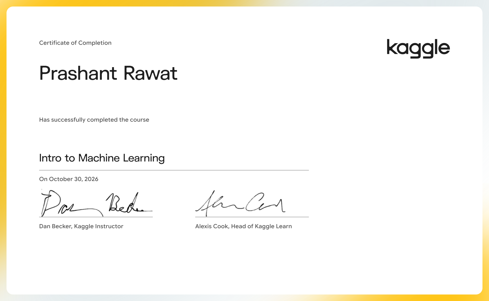

# Intro to Machine Learning

Learn the core ideas in machine learning, and build your first models.

- Course: [Intro to Machine Learning on Kaggle Learn](https://www.kaggle.com/learn/intro-to-machine-learning)
- Instructor(s): Dan Becker
- Completed: 2026-10-30

## Lessons

| # | Lesson | Tutorial | Exercise | Solved exercise | Notes |
|---|---|---|---|---|---|
| 1 | How Models Work | [ipynb](01-How-Models-Work/tutorial.ipynb) · [md](01-How-Models-Work/tutorial.md) | — | — | [notes](01-How-Models-Work/notes.md) |
| 2 | Basic Data Exploration | [ipynb](02-Basic-Data-Exploration/tutorial.ipynb) · [md](02-Basic-Data-Exploration/tutorial.md) | [ipynb](02-Basic-Data-Exploration/exercise.ipynb) · [md](02-Basic-Data-Exploration/exercise.md) | [ipynb](02-Basic-Data-Exploration/exercise-solved.ipynb) · [md](02-Basic-Data-Exploration/exercise-solved.md) | [notes](02-Basic-Data-Exploration/notes.md) |
| 3 | Your First Machine Learning Model | [ipynb](03-Your-First-Machine-Learning-Model/tutorial.ipynb) · [md](03-Your-First-Machine-Learning-Model/tutorial.md) | [ipynb](03-Your-First-Machine-Learning-Model/exercise.ipynb) · [md](03-Your-First-Machine-Learning-Model/exercise.md) | [ipynb](03-Your-First-Machine-Learning-Model/exercise-solved.ipynb) · [md](03-Your-First-Machine-Learning-Model/exercise-solved.md) | [notes](03-Your-First-Machine-Learning-Model/notes.md) |
| 4 | Model Validation | [ipynb](04-Model-Validation/tutorial.ipynb) · [md](04-Model-Validation/tutorial.md) | [ipynb](04-Model-Validation/exercise.ipynb) · [md](04-Model-Validation/exercise.md) | [ipynb](04-Model-Validation/exercise-solved.ipynb) · [md](04-Model-Validation/exercise-solved.md) | [notes](04-Model-Validation/notes.md) |
| 5 | Underfitting and Overfitting | [ipynb](05-Underfitting-and-Overfitting/tutorial.ipynb) · [md](05-Underfitting-and-Overfitting/tutorial.md) | [ipynb](05-Underfitting-and-Overfitting/exercise.ipynb) · [md](05-Underfitting-and-Overfitting/exercise.md) | [ipynb](05-Underfitting-and-Overfitting/exercise-solved.ipynb) · [md](05-Underfitting-and-Overfitting/exercise-solved.md) | [notes](05-Underfitting-and-Overfitting/notes.md) |
| 6 | Random Forests | [ipynb](06-Random-Forests/tutorial.ipynb) · [md](06-Random-Forests/tutorial.md) | [ipynb](06-Random-Forests/exercise.ipynb) · [md](06-Random-Forests/exercise.md) | [ipynb](06-Random-Forests/exercise-solved.ipynb) · [md](06-Random-Forests/exercise-solved.md) | [notes](06-Random-Forests/notes.md) |
| 7 | Machine Learning Competitions | [ipynb](07-Machine-Learning-Competitions/tutorial.ipynb) · [md](07-Machine-Learning-Competitions/tutorial.md) | [ipynb](07-Machine-Learning-Competitions/exercise.ipynb) · [md](07-Machine-Learning-Competitions/exercise.md) | [ipynb](07-Machine-Learning-Competitions/exercise-solved.ipynb) · [md](07-Machine-Learning-Competitions/exercise-solved.md) | [notes](07-Machine-Learning-Competitions/notes.md) |

## Data used by the exercises

- [dansbecker/home-data-for-ml-course](https://www.kaggle.com/datasets/dansbecker/home-data-for-ml-course)
- [dansbecker/melbourne-housing-snapshot](https://www.kaggle.com/datasets/dansbecker/melbourne-housing-snapshot)
- [home-data-for-ml-course](https://www.kaggle.com/competitions/home-data-for-ml-course)
- [iabhishekofficial/mobile-price-classification](https://www.kaggle.com/datasets/iabhishekofficial/mobile-price-classification)

## Running the notebooks

The notebooks expect Kaggle's environment (the `learntools` checking package and data under `../input/`). The easiest way to run one is to open the exercise on Kaggle from the links above, or import the `.ipynb` into a Kaggle notebook and attach the datasets listed here.
