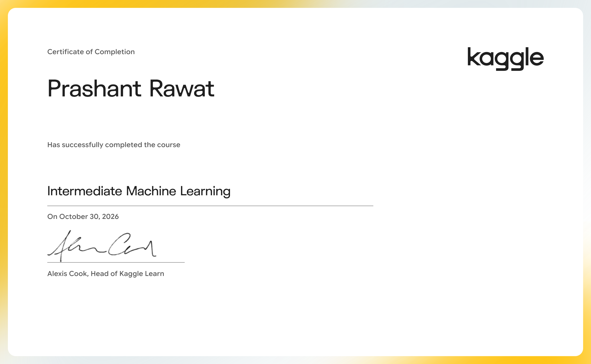

# Intermediate Machine Learning

Handle missing values, non-numeric values, data leakage, and more.

- Course: [Intermediate Machine Learning on Kaggle Learn](https://www.kaggle.com/learn/intermediate-machine-learning)
- Instructor(s): Alexis Cook
- Completed: 2026-10-30

## Lessons

| # | Lesson | Tutorial | Exercise | Solved exercise | Notes |
|---|---|---|---|---|---|
| 1 | Introduction | [ipynb](01-Introduction/tutorial.ipynb) · [md](01-Introduction/tutorial.md) | [ipynb](01-Introduction/exercise.ipynb) · [md](01-Introduction/exercise.md) | [ipynb](01-Introduction/exercise-solved.ipynb) · [md](01-Introduction/exercise-solved.md) | [notes](01-Introduction/notes.md) |
| 2 | Missing Values | [ipynb](02-Missing-Values/tutorial.ipynb) · [md](02-Missing-Values/tutorial.md) | [ipynb](02-Missing-Values/exercise.ipynb) · [md](02-Missing-Values/exercise.md) | [ipynb](02-Missing-Values/exercise-solved.ipynb) · [md](02-Missing-Values/exercise-solved.md) | [notes](02-Missing-Values/notes.md) |
| 3 | Categorical Variables | [ipynb](03-Categorical-Variables/tutorial.ipynb) · [md](03-Categorical-Variables/tutorial.md) | [ipynb](03-Categorical-Variables/exercise.ipynb) · [md](03-Categorical-Variables/exercise.md) | [ipynb](03-Categorical-Variables/exercise-solved.ipynb) · [md](03-Categorical-Variables/exercise-solved.md) | [notes](03-Categorical-Variables/notes.md) |
| 4 | Pipelines | [ipynb](04-Pipelines/tutorial.ipynb) · [md](04-Pipelines/tutorial.md) | [ipynb](04-Pipelines/exercise.ipynb) · [md](04-Pipelines/exercise.md) | [ipynb](04-Pipelines/exercise-solved.ipynb) · [md](04-Pipelines/exercise-solved.md) | [notes](04-Pipelines/notes.md) |
| 5 | Cross-Validation | [ipynb](05-Cross-Validation/tutorial.ipynb) · [md](05-Cross-Validation/tutorial.md) | [ipynb](05-Cross-Validation/exercise.ipynb) · [md](05-Cross-Validation/exercise.md) | [ipynb](05-Cross-Validation/exercise-solved.ipynb) · [md](05-Cross-Validation/exercise-solved.md) | [notes](05-Cross-Validation/notes.md) |
| 6 | XGBoost | [ipynb](06-XGBoost/tutorial.ipynb) · [md](06-XGBoost/tutorial.md) | [ipynb](06-XGBoost/exercise.ipynb) · [md](06-XGBoost/exercise.md) | [ipynb](06-XGBoost/exercise-solved.ipynb) · [md](06-XGBoost/exercise-solved.md) | [notes](06-XGBoost/notes.md) |
| 7 | Data Leakage | [ipynb](07-Data-Leakage/tutorial.ipynb) · [md](07-Data-Leakage/tutorial.md) | [ipynb](07-Data-Leakage/exercise.ipynb) · [md](07-Data-Leakage/exercise.md) | [ipynb](07-Data-Leakage/exercise-solved.ipynb) · [md](07-Data-Leakage/exercise-solved.md) | [notes](07-Data-Leakage/notes.md) |

## Data used by the exercises

- [home-data-for-ml-course](https://www.kaggle.com/competitions/home-data-for-ml-course)

## Running the notebooks

The notebooks expect Kaggle's environment (the `learntools` checking package and data under `../input/`). The easiest way to run one is to open the exercise on Kaggle from the links above, or import the `.ipynb` into a Kaggle notebook and attach the datasets listed here.
