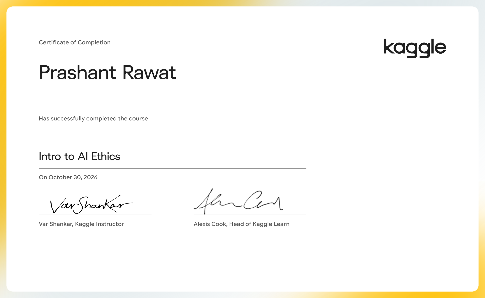

# Intro to AI Ethics

Explore practical tools to guide the moral design of AI systems.

- Course: [Intro to AI Ethics on Kaggle Learn](https://www.kaggle.com/learn/intro-to-ai-ethics)
- Instructor(s): Var Shankar, Alexis Cook
- Completed: 2026-10-30

## Lessons

| # | Lesson | Tutorial | Exercise | Solved exercise | Notes |
|---|---|---|---|---|---|
| 1 | Introduction to AI Ethics | [ipynb](01-Introduction-to-AI-Ethics/tutorial.ipynb) · [md](01-Introduction-to-AI-Ethics/tutorial.md) | — | — | [notes](01-Introduction-to-AI-Ethics/notes.md) |
| 2 | Human-Centered Design for AI | [ipynb](02-Human-Centered-Design-for-AI/tutorial.ipynb) · [md](02-Human-Centered-Design-for-AI/tutorial.md) | [ipynb](02-Human-Centered-Design-for-AI/exercise.ipynb) · [md](02-Human-Centered-Design-for-AI/exercise.md) | [ipynb](02-Human-Centered-Design-for-AI/exercise-solved.ipynb) · [md](02-Human-Centered-Design-for-AI/exercise-solved.md) | [notes](02-Human-Centered-Design-for-AI/notes.md) |
| 3 | Identifying Bias in AI | [ipynb](03-Identifying-Bias-in-AI/tutorial.ipynb) · [md](03-Identifying-Bias-in-AI/tutorial.md) | [ipynb](03-Identifying-Bias-in-AI/exercise.ipynb) · [md](03-Identifying-Bias-in-AI/exercise.md) | [ipynb](03-Identifying-Bias-in-AI/exercise-solved.ipynb) · [md](03-Identifying-Bias-in-AI/exercise-solved.md) | [notes](03-Identifying-Bias-in-AI/notes.md) |
| 4 | AI Fairness | [ipynb](04-AI-Fairness/tutorial.ipynb) · [md](04-AI-Fairness/tutorial.md) | [ipynb](04-AI-Fairness/exercise.ipynb) · [md](04-AI-Fairness/exercise.md) | [ipynb](04-AI-Fairness/exercise-solved.ipynb) · [md](04-AI-Fairness/exercise-solved.md) | [notes](04-AI-Fairness/notes.md) |
| 5 | Model Cards | [ipynb](05-Model-Cards/tutorial.ipynb) · [md](05-Model-Cards/tutorial.md) | [ipynb](05-Model-Cards/exercise.ipynb) · [md](05-Model-Cards/exercise.md) | [ipynb](05-Model-Cards/exercise-solved.ipynb) · [md](05-Model-Cards/exercise-solved.md) | [notes](05-Model-Cards/notes.md) |

## Data used by the exercises

- [alexisbcook/jigsaw-snapshot](https://www.kaggle.com/datasets/alexisbcook/jigsaw-snapshot)
- [alexisbcook/synthetic-credit-card-approval](https://www.kaggle.com/datasets/alexisbcook/synthetic-credit-card-approval)

## Running the notebooks

The notebooks expect Kaggle's environment (the `learntools` checking package and data under `../input/`). The easiest way to run one is to open the exercise on Kaggle from the links above, or import the `.ipynb` into a Kaggle notebook and attach the datasets listed here.
