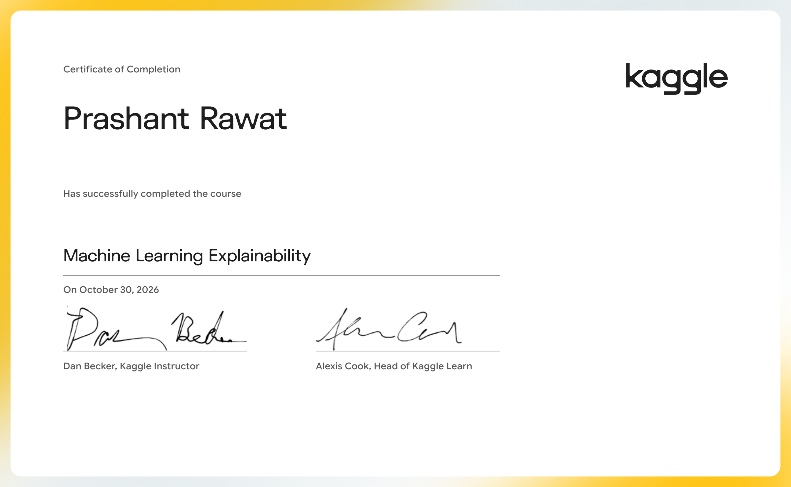

# Machine Learning Explainability

Extract human-understandable insights from any machine learning model.

- Course: [Machine Learning Explainability on Kaggle Learn](https://www.kaggle.com/learn/machine-learning-explainability)
- Instructor(s): Dan Becker
- Completed: 2026-10-30

## Lessons

| # | Lesson | Tutorial | Exercise | Solved exercise | Notes |
|---|---|---|---|---|---|
| 1 | Use Cases for Model Insights | [ipynb](01-Use-Cases-for-Model-Insights/tutorial.ipynb) · [md](01-Use-Cases-for-Model-Insights/tutorial.md) | — | — | [notes](01-Use-Cases-for-Model-Insights/notes.md) |
| 2 | Permutation Importance | [ipynb](02-Permutation-Importance/tutorial.ipynb) · [md](02-Permutation-Importance/tutorial.md) | [ipynb](02-Permutation-Importance/exercise.ipynb) · [md](02-Permutation-Importance/exercise.md) | [ipynb](02-Permutation-Importance/exercise-solved.ipynb) · [md](02-Permutation-Importance/exercise-solved.md) | [notes](02-Permutation-Importance/notes.md) |
| 3 | Partial Plots | [ipynb](03-Partial-Plots/tutorial.ipynb) · [md](03-Partial-Plots/tutorial.md) | [ipynb](03-Partial-Plots/exercise.ipynb) · [md](03-Partial-Plots/exercise.md) | [ipynb](03-Partial-Plots/exercise-solved.ipynb) · [md](03-Partial-Plots/exercise-solved.md) | [notes](03-Partial-Plots/notes.md) |
| 4 | SHAP Values | [ipynb](04-SHAP-Values/tutorial.ipynb) · [md](04-SHAP-Values/tutorial.md) | [ipynb](04-SHAP-Values/exercise.ipynb) · [md](04-SHAP-Values/exercise.md) | [ipynb](04-SHAP-Values/exercise-solved.ipynb) · [md](04-SHAP-Values/exercise-solved.md) | [notes](04-SHAP-Values/notes.md) |
| 5 | Advanced Uses of SHAP Values | [ipynb](05-Advanced-Uses-of-SHAP-Values/tutorial.ipynb) · [md](05-Advanced-Uses-of-SHAP-Values/tutorial.md) | [ipynb](05-Advanced-Uses-of-SHAP-Values/exercise.ipynb) · [md](05-Advanced-Uses-of-SHAP-Values/exercise.md) | [ipynb](05-Advanced-Uses-of-SHAP-Values/exercise-solved.ipynb) · [md](05-Advanced-Uses-of-SHAP-Values/exercise-solved.md) | [notes](05-Advanced-Uses-of-SHAP-Values/notes.md) |

## Data used by the exercises

- [dansbecker/hospital-readmissions](https://www.kaggle.com/datasets/dansbecker/hospital-readmissions)
- [dansbecker/new-york-city-taxi-fare-prediction](https://www.kaggle.com/datasets/dansbecker/new-york-city-taxi-fare-prediction)
- [mathan/fifa-2018-match-statistics](https://www.kaggle.com/datasets/mathan/fifa-2018-match-statistics)

## Running the notebooks

The notebooks expect Kaggle's environment (the `learntools` checking package and data under `../input/`). The easiest way to run one is to open the exercise on Kaggle from the links above, or import the `.ipynb` into a Kaggle notebook and attach the datasets listed here.
