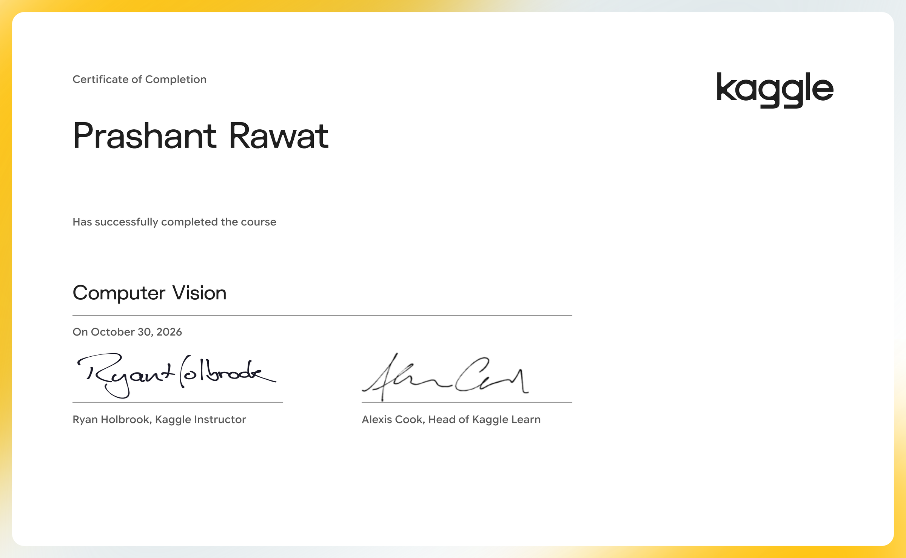

# Computer Vision

Build convolutional neural networks with TensorFlow and Keras.

- Course: [Computer Vision on Kaggle Learn](https://www.kaggle.com/learn/computer-vision)
- Instructor(s): Ryan Holbrook
- Completed: 2026-10-30

## Lessons

| # | Lesson | Tutorial | Exercise | Solved exercise | Notes |
|---|---|---|---|---|---|
| 1 | The Convolutional Classifier | [ipynb](01-The-Convolutional-Classifier/tutorial.ipynb) · [md](01-The-Convolutional-Classifier/tutorial.md) | [ipynb](01-The-Convolutional-Classifier/exercise.ipynb) · [md](01-The-Convolutional-Classifier/exercise.md) | [ipynb](01-The-Convolutional-Classifier/exercise-solved.ipynb) · [md](01-The-Convolutional-Classifier/exercise-solved.md) | [notes](01-The-Convolutional-Classifier/notes.md) |
| 2 | Convolution and ReLU | [ipynb](02-Convolution-and-ReLU/tutorial.ipynb) · [md](02-Convolution-and-ReLU/tutorial.md) | [ipynb](02-Convolution-and-ReLU/exercise.ipynb) · [md](02-Convolution-and-ReLU/exercise.md) | [ipynb](02-Convolution-and-ReLU/exercise-solved.ipynb) · [md](02-Convolution-and-ReLU/exercise-solved.md) | [notes](02-Convolution-and-ReLU/notes.md) |
| 3 | Maximum Pooling | [ipynb](03-Maximum-Pooling/tutorial.ipynb) · [md](03-Maximum-Pooling/tutorial.md) | [ipynb](03-Maximum-Pooling/exercise.ipynb) · [md](03-Maximum-Pooling/exercise.md) | [ipynb](03-Maximum-Pooling/exercise-solved.ipynb) · [md](03-Maximum-Pooling/exercise-solved.md) | [notes](03-Maximum-Pooling/notes.md) |
| 4 | The Sliding Window | [ipynb](04-The-Sliding-Window/tutorial.ipynb) · [md](04-The-Sliding-Window/tutorial.md) | [ipynb](04-The-Sliding-Window/exercise.ipynb) · [md](04-The-Sliding-Window/exercise.md) | [ipynb](04-The-Sliding-Window/exercise-solved.ipynb) · [md](04-The-Sliding-Window/exercise-solved.md) | [notes](04-The-Sliding-Window/notes.md) |
| 5 | Custom Convnets | [ipynb](05-Custom-Convnets/tutorial.ipynb) · [md](05-Custom-Convnets/tutorial.md) | [ipynb](05-Custom-Convnets/exercise.ipynb) · [md](05-Custom-Convnets/exercise.md) | [ipynb](05-Custom-Convnets/exercise-solved.ipynb) · [md](05-Custom-Convnets/exercise-solved.md) | [notes](05-Custom-Convnets/notes.md) |
| 6 | Data Augmentation | [ipynb](06-Data-Augmentation/tutorial.ipynb) · [md](06-Data-Augmentation/tutorial.md) | [ipynb](06-Data-Augmentation/exercise.ipynb) · [md](06-Data-Augmentation/exercise.md) | [ipynb](06-Data-Augmentation/exercise-solved.ipynb) · [md](06-Data-Augmentation/exercise-solved.md) | [notes](06-Data-Augmentation/notes.md) |

## Data used by the exercises

- [ryanholbrook/car-or-truck](https://www.kaggle.com/datasets/ryanholbrook/car-or-truck)
- [ryanholbrook/computer-vision-resources](https://www.kaggle.com/datasets/ryanholbrook/computer-vision-resources)
- [ryanholbrook/cv-course-models](https://www.kaggle.com/datasets/ryanholbrook/cv-course-models)
- [ryanholbrook/eurosat](https://www.kaggle.com/datasets/ryanholbrook/eurosat)
- [ryanholbrook/tensorflow-flowers](https://www.kaggle.com/datasets/ryanholbrook/tensorflow-flowers)

## Running the notebooks

The notebooks expect Kaggle's environment (the `learntools` checking package and data under `../input/`). The easiest way to run one is to open the exercise on Kaggle from the links above, or import the `.ipynb` into a Kaggle notebook and attach the datasets listed here.
