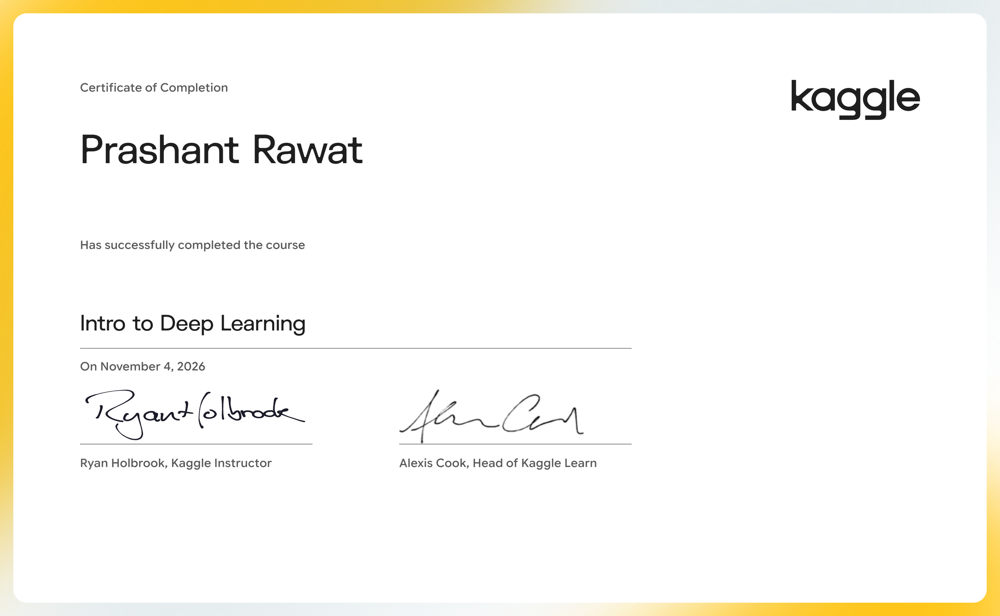

# Intro to Deep Learning

Use TensorFlow and Keras to build and train neural networks for structured data.

- Course: [Intro to Deep Learning on Kaggle Learn](https://www.kaggle.com/learn/intro-to-deep-learning)
- Instructor(s): Ryan Holbrook
- Completed: 2026-11-04

## Lessons

| # | Lesson | Tutorial | Exercise | Solved exercise | Notes |
|---|---|---|---|---|---|
| 1 | A Single Neuron | [ipynb](01-A-Single-Neuron/tutorial.ipynb) · [md](01-A-Single-Neuron/tutorial.md) | [ipynb](01-A-Single-Neuron/exercise.ipynb) · [md](01-A-Single-Neuron/exercise.md) | [ipynb](01-A-Single-Neuron/exercise-solved.ipynb) · [md](01-A-Single-Neuron/exercise-solved.md) | [notes](01-A-Single-Neuron/notes.md) |
| 2 | Deep Neural Networks | [ipynb](02-Deep-Neural-Networks/tutorial.ipynb) · [md](02-Deep-Neural-Networks/tutorial.md) | [ipynb](02-Deep-Neural-Networks/exercise.ipynb) · [md](02-Deep-Neural-Networks/exercise.md) | [ipynb](02-Deep-Neural-Networks/exercise-solved.ipynb) · [md](02-Deep-Neural-Networks/exercise-solved.md) | [notes](02-Deep-Neural-Networks/notes.md) |
| 3 | Stochastic Gradient Descent | [ipynb](03-Stochastic-Gradient-Descent/tutorial.ipynb) · [md](03-Stochastic-Gradient-Descent/tutorial.md) | [ipynb](03-Stochastic-Gradient-Descent/exercise.ipynb) · [md](03-Stochastic-Gradient-Descent/exercise.md) | [ipynb](03-Stochastic-Gradient-Descent/exercise-solved.ipynb) · [md](03-Stochastic-Gradient-Descent/exercise-solved.md) | [notes](03-Stochastic-Gradient-Descent/notes.md) |
| 4 | Overfitting and Underfitting | [ipynb](04-Overfitting-and-Underfitting/tutorial.ipynb) · [md](04-Overfitting-and-Underfitting/tutorial.md) | [ipynb](04-Overfitting-and-Underfitting/exercise.ipynb) · [md](04-Overfitting-and-Underfitting/exercise.md) | [ipynb](04-Overfitting-and-Underfitting/exercise-solved.ipynb) · [md](04-Overfitting-and-Underfitting/exercise-solved.md) | [notes](04-Overfitting-and-Underfitting/notes.md) |
| 5 | Dropout and Batch Normalization | [ipynb](05-Dropout-and-Batch-Normalization/tutorial.ipynb) · [md](05-Dropout-and-Batch-Normalization/tutorial.md) | [ipynb](05-Dropout-and-Batch-Normalization/exercise.ipynb) · [md](05-Dropout-and-Batch-Normalization/exercise.md) | [ipynb](05-Dropout-and-Batch-Normalization/exercise-solved.ipynb) · [md](05-Dropout-and-Batch-Normalization/exercise-solved.md) | [notes](05-Dropout-and-Batch-Normalization/notes.md) |
| 6 | Binary Classification | [ipynb](06-Binary-Classification/tutorial.ipynb) · [md](06-Binary-Classification/tutorial.md) | [ipynb](06-Binary-Classification/exercise.ipynb) · [md](06-Binary-Classification/exercise.md) | [ipynb](06-Binary-Classification/exercise-solved.ipynb) · [md](06-Binary-Classification/exercise-solved.md) | [notes](06-Binary-Classification/notes.md) |

## Data used by the exercises

- [ryanholbrook/dl-course-data](https://www.kaggle.com/datasets/ryanholbrook/dl-course-data)

## Running the notebooks

The notebooks expect Kaggle's environment (the `learntools` checking package and data under `../input/`). The easiest way to run one is to open the exercise on Kaggle from the links above, or import the `.ipynb` into a Kaggle notebook and attach the datasets listed here.
