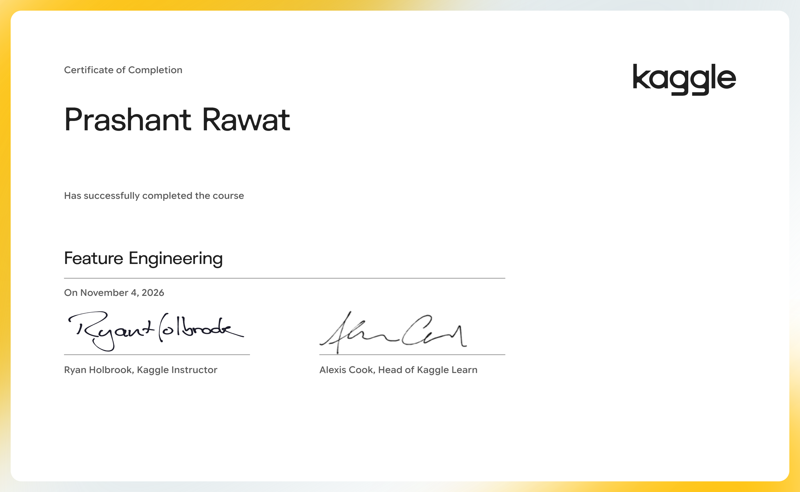

# Feature Engineering

Better features make better models. Discover how to get the most out of your data.

- Course: [Feature Engineering on Kaggle Learn](https://www.kaggle.com/learn/feature-engineering)
- Instructor(s): Ryan Holbrook
- Completed: 2026-11-04

## Lessons

| # | Lesson | Tutorial | Exercise | Solved exercise | Notes |
|---|---|---|---|---|---|
| 1 | What Is Feature Engineering | [ipynb](01-What-Is-Feature-Engineering/tutorial.ipynb) · [md](01-What-Is-Feature-Engineering/tutorial.md) | — | — | [notes](01-What-Is-Feature-Engineering/notes.md) |
| 2 | Mutual Information | [ipynb](02-Mutual-Information/tutorial.ipynb) · [md](02-Mutual-Information/tutorial.md) | [ipynb](02-Mutual-Information/exercise.ipynb) · [md](02-Mutual-Information/exercise.md) | [ipynb](02-Mutual-Information/exercise-solved.ipynb) · [md](02-Mutual-Information/exercise-solved.md) | [notes](02-Mutual-Information/notes.md) |
| 3 | Creating Features | [ipynb](03-Creating-Features/tutorial.ipynb) · [md](03-Creating-Features/tutorial.md) | [ipynb](03-Creating-Features/exercise.ipynb) · [md](03-Creating-Features/exercise.md) | [ipynb](03-Creating-Features/exercise-solved.ipynb) · [md](03-Creating-Features/exercise-solved.md) | [notes](03-Creating-Features/notes.md) |
| 4 | Clustering With K-Means | [ipynb](04-Clustering-With-K-Means/tutorial.ipynb) · [md](04-Clustering-With-K-Means/tutorial.md) | [ipynb](04-Clustering-With-K-Means/exercise.ipynb) · [md](04-Clustering-With-K-Means/exercise.md) | [ipynb](04-Clustering-With-K-Means/exercise-solved.ipynb) · [md](04-Clustering-With-K-Means/exercise-solved.md) | [notes](04-Clustering-With-K-Means/notes.md) |
| 5 | Principal Component Analysis | [ipynb](05-Principal-Component-Analysis/tutorial.ipynb) · [md](05-Principal-Component-Analysis/tutorial.md) | [ipynb](05-Principal-Component-Analysis/exercise.ipynb) · [md](05-Principal-Component-Analysis/exercise.md) | [ipynb](05-Principal-Component-Analysis/exercise-solved.ipynb) · [md](05-Principal-Component-Analysis/exercise-solved.md) | [notes](05-Principal-Component-Analysis/notes.md) |
| 6 | Target Encoding | [ipynb](06-Target-Encoding/tutorial.ipynb) · [md](06-Target-Encoding/tutorial.md) | [ipynb](06-Target-Encoding/exercise.ipynb) · [md](06-Target-Encoding/exercise.md) | [ipynb](06-Target-Encoding/exercise-solved.ipynb) · [md](06-Target-Encoding/exercise-solved.md) | [notes](06-Target-Encoding/notes.md) |

## Data used by the exercises

- [ryanholbrook/fe-course-data](https://www.kaggle.com/datasets/ryanholbrook/fe-course-data)

## Running the notebooks

The notebooks expect Kaggle's environment (the `learntools` checking package and data under `../input/`). The easiest way to run one is to open the exercise on Kaggle from the links above, or import the `.ipynb` into a Kaggle notebook and attach the datasets listed here.
