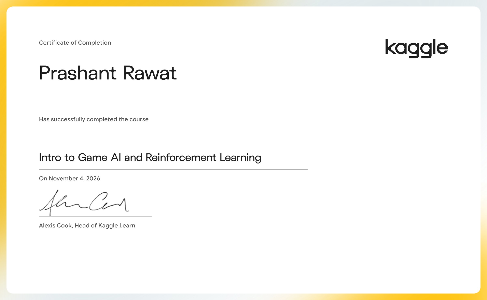

# Intro to Game AI and Reinforcement Learning

Build your own video game bots, using classic and cutting-edge algorithms.

- Course: [Intro to Game AI and Reinforcement Learning on Kaggle Learn](https://www.kaggle.com/learn/intro-to-game-ai-and-reinforcement-learning)
- Instructor(s): Alexis Cook
- Completed: 2026-11-04

## Lessons

| # | Lesson | Tutorial | Exercise | Solved exercise | Notes |
|---|---|---|---|---|---|
| 1 | Play the Game | [ipynb](01-Play-the-Game/tutorial.ipynb) · [md](01-Play-the-Game/tutorial.md) | [ipynb](01-Play-the-Game/exercise.ipynb) · [md](01-Play-the-Game/exercise.md) | [ipynb](01-Play-the-Game/exercise-solved.ipynb) · [md](01-Play-the-Game/exercise-solved.md) | [notes](01-Play-the-Game/notes.md) |
| 2 | One-Step Lookahead | [ipynb](02-One-Step-Lookahead/tutorial.ipynb) · [md](02-One-Step-Lookahead/tutorial.md) | [ipynb](02-One-Step-Lookahead/exercise.ipynb) · [md](02-One-Step-Lookahead/exercise.md) | [ipynb](02-One-Step-Lookahead/exercise-solved.ipynb) · [md](02-One-Step-Lookahead/exercise-solved.md) | [notes](02-One-Step-Lookahead/notes.md) |
| 3 | N-Step Lookahead | [ipynb](03-N-Step-Lookahead/tutorial.ipynb) · [md](03-N-Step-Lookahead/tutorial.md) | [ipynb](03-N-Step-Lookahead/exercise.ipynb) · [md](03-N-Step-Lookahead/exercise.md) | [ipynb](03-N-Step-Lookahead/exercise-solved.ipynb) · [md](03-N-Step-Lookahead/exercise-solved.md) | [notes](03-N-Step-Lookahead/notes.md) |
| 4 | Deep Reinforcement Learning | [ipynb](04-Deep-Reinforcement-Learning/tutorial.ipynb) · [md](04-Deep-Reinforcement-Learning/tutorial.md) | [ipynb](04-Deep-Reinforcement-Learning/exercise.ipynb) · [md](04-Deep-Reinforcement-Learning/exercise.md) | [ipynb](04-Deep-Reinforcement-Learning/exercise-solved.ipynb) · [md](04-Deep-Reinforcement-Learning/exercise-solved.md) | [notes](04-Deep-Reinforcement-Learning/notes.md) |

## Data used by the exercises

- [connectx](https://www.kaggle.com/competitions/connectx)

## Running the notebooks

The notebooks expect Kaggle's environment (the `learntools` checking package and data under `../input/`). The easiest way to run one is to open the exercise on Kaggle from the links above, or import the `.ipynb` into a Kaggle notebook and attach the datasets listed here.
