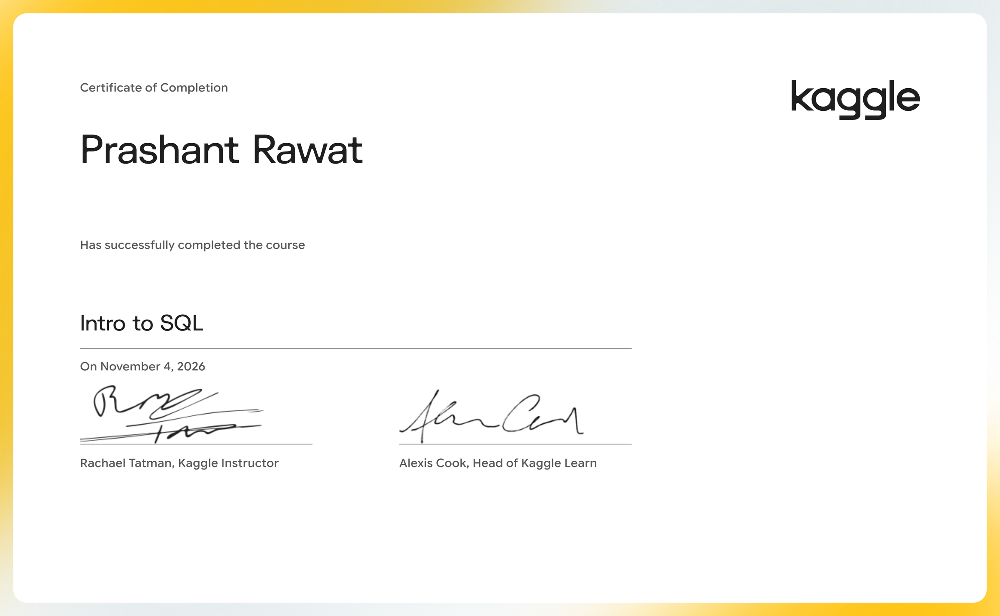

# Intro to SQL

Learn SQL for working with databases, using Google BigQuery.

- Course: [Intro to SQL on Kaggle Learn](https://www.kaggle.com/learn/intro-to-sql)
- Instructor(s): Rachael Tatman, Alexis Cook
- Completed: 2026-11-04

## Lessons

| # | Lesson | Tutorial | Exercise | Solved exercise | Notes |
|---|---|---|---|---|---|
| 1 | Getting Started With SQL and BigQuery | [ipynb](01-Getting-Started-With-SQL-and-BigQuery/tutorial.ipynb) · [md](01-Getting-Started-With-SQL-and-BigQuery/tutorial.md) | [ipynb](01-Getting-Started-With-SQL-and-BigQuery/exercise.ipynb) · [md](01-Getting-Started-With-SQL-and-BigQuery/exercise.md) | [ipynb](01-Getting-Started-With-SQL-and-BigQuery/exercise-solved.ipynb) · [md](01-Getting-Started-With-SQL-and-BigQuery/exercise-solved.md) | [notes](01-Getting-Started-With-SQL-and-BigQuery/notes.md) |
| 2 | Select, From & Where | [ipynb](02-Select-From-and-Where/tutorial.ipynb) · [md](02-Select-From-and-Where/tutorial.md) | [ipynb](02-Select-From-and-Where/exercise.ipynb) · [md](02-Select-From-and-Where/exercise.md) | [ipynb](02-Select-From-and-Where/exercise-solved.ipynb) · [md](02-Select-From-and-Where/exercise-solved.md) | [notes](02-Select-From-and-Where/notes.md) |
| 3 | Group By, Having & Count | [ipynb](03-Group-By-Having-and-Count/tutorial.ipynb) · [md](03-Group-By-Having-and-Count/tutorial.md) | [ipynb](03-Group-By-Having-and-Count/exercise.ipynb) · [md](03-Group-By-Having-and-Count/exercise.md) | [ipynb](03-Group-By-Having-and-Count/exercise-solved.ipynb) · [md](03-Group-By-Having-and-Count/exercise-solved.md) | [notes](03-Group-By-Having-and-Count/notes.md) |
| 4 | Order By | [ipynb](04-Order-By/tutorial.ipynb) · [md](04-Order-By/tutorial.md) | [ipynb](04-Order-By/exercise.ipynb) · [md](04-Order-By/exercise.md) | [ipynb](04-Order-By/exercise-solved.ipynb) · [md](04-Order-By/exercise-solved.md) | [notes](04-Order-By/notes.md) |
| 5 | As & With | [ipynb](05-As-and-With/tutorial.ipynb) · [md](05-As-and-With/tutorial.md) | [ipynb](05-As-and-With/exercise.ipynb) · [md](05-As-and-With/exercise.md) | [ipynb](05-As-and-With/exercise-solved.ipynb) · [md](05-As-and-With/exercise-solved.md) | [notes](05-As-and-With/notes.md) |
| 6 | Joining Data | [ipynb](06-Joining-Data/tutorial.ipynb) · [md](06-Joining-Data/tutorial.md) | [ipynb](06-Joining-Data/exercise.ipynb) · [md](06-Joining-Data/exercise.md) | [ipynb](06-Joining-Data/exercise-solved.ipynb) · [md](06-Joining-Data/exercise-solved.md) | [notes](06-Joining-Data/notes.md) |

## Data used by the exercises

- [bigquery/bitcoin-blockchain](https://www.kaggle.com/datasets/bigquery/bitcoin-blockchain)
- [chicago/chicago-crime](https://www.kaggle.com/datasets/chicago/chicago-crime)
- [chicago/chicago-taxi-trips-bq](https://www.kaggle.com/datasets/chicago/chicago-taxi-trips-bq)
- [hacker-news/hacker-news](https://www.kaggle.com/datasets/hacker-news/hacker-news)
- [open-aq/openaq](https://www.kaggle.com/datasets/open-aq/openaq)
- [stackoverflow/stackoverflow](https://www.kaggle.com/datasets/stackoverflow/stackoverflow)
- [theworldbank/world-bank-intl-education](https://www.kaggle.com/datasets/theworldbank/world-bank-intl-education)
- [usdot/nhtsa-traffic-fatalities](https://www.kaggle.com/datasets/usdot/nhtsa-traffic-fatalities)

## Running the notebooks

The notebooks expect Kaggle's environment (the `learntools` checking package and data under `../input/`). The easiest way to run one is to open the exercise on Kaggle from the links above, or import the `.ipynb` into a Kaggle notebook and attach the datasets listed here.
